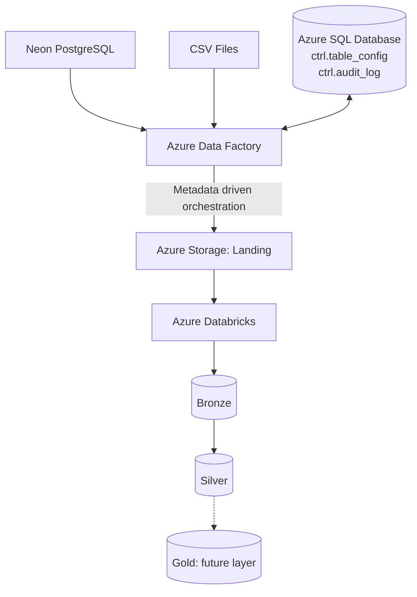

# CareSync: Healthcare Data Engineering Platform
 


 
CareSync is an end to end data engineering project for healthcare data. It brings data from two different sources into a Lakehouse on Azure. It also keeps a log of every run.
 
The project shows how to build a metadata driven ETL pipeline. One configuration table controls all the tables. There is no need to build a new pipeline for each source table.
 
## What this project does
 
- Reads data from two source types: Neon PostgreSQL and CSV files.
- Supports full load and incremental load for relational sources.
- Saves the raw data in Azure Storage (Landing layer).
- Processes the data in Azure Databricks (Bronze and Silver layers).
- Saves the pipeline settings and the watermarks in Azure SQL Database.
- Writes an audit record for every table and every run.
## Architecture
 
The current version follows a Landing, Bronze and Silver design. The Gold layer is planned for the future.
 

 
Azure Data Factory controls the whole workflow. Azure SQL Database works next to it. It stores the configuration and the audit records.
 
## Technology stack
 
| Technology | Purpose |
|---|---|
| Azure Data Factory | Pipeline orchestration and data ingestion |
| Azure Databricks | Data processing and transformations |
| Apache Spark / PySpark | Data transformation |
| Azure SQL Database | Metadata and audit logging |
| Azure Storage | Landing data storage |
| Neon PostgreSQL | Relational source database |
| CSV Files | File based data sources |
| Unity Catalog | Data governance and volumes |
| SQL | Configuration queries and watermark management |
| Python | Data processing logic |
 
## Data sources
 
CareSync reads from different source types. All of them use the same ingestion design.
 
### Neon PostgreSQL
 
Azure Data Factory extracts the relational data from Neon PostgreSQL. This source supports:
 
- Full extraction
- Incremental extraction
- Watermark based change tracking
- Configurable source tables
### CSV files
 
Azure Data Factory also ingests structured datasets from CSV files. This way file data and database data can live together in the same platform.
 
Both sources feed the same Bronze and Silver processing.
 
## How it works
 
### 1. Metadata driven orchestration
 
A central table called `ctrl.table_config` tells the pipeline how to process each table. It stores:
 
- Source system
- Source table name
- Load type
- Watermark column
- Current watermark value
- Merge keys
- Active status
The main pipeline reads all active tables. Then it uses a `ForEach` activity to go through them. For each table it runs an Inner Pipeline. This way the same logic is reused for every table.
 
### 2. Full and incremental load
 
For relational sources the pipeline has two loading strategies.
 
**Full load** reads all the records from the source table.
 
**Incremental load** reads only the records that changed since the last successful run. It uses the watermark column.
 
The incremental query uses a fixed time window:
 
```sql
WHERE watermark_column > previous_watermark
  AND watermark_column <= current_start_time
```
 
The upper limit is saved once at the start of the run. This way new records that arrive during the extraction do not enter the current batch. After a successful run the watermark is updated in `ctrl.table_config`.
 
### 3. Landing layer
 
Azure Data Factory saves the source data in Azure Storage. The landing layer is one central place for all source systems. Each ingestion batch has its own folder so it is easy to find.
 
```text
landing/
├── neon_postgres/
│   ├── doctors/
│   │   └── YYYY-MM-DD_HH-mm-ss/
│   ├── hospitals/
│   │   └── YYYY-MM-DD_HH-mm-ss/
│   └── patients/
│       └── YYYY-MM-DD_HH-mm-ss/
│
└── csv_files/
    └── source_dataset/
        └── ingestion_batch/
```
 
### 4. Bronze layer
 
The `Landing_to_bronze` notebook reads the landing data from a Unity Catalog Volume. It receives parameters like these:
 
- `landing_timestamp`
- `source_system`
- `table_name`
The notebook uses them to find and process the correct batch.
 
### 5. Silver layer
 
The `Bronze_to_Silver` notebook does these steps:
 
1. Reads the selected Bronze table.
2. Filters the records with the landing timestamp.
3. Adds processing timestamp columns.
4. Writes the data to the Silver layer.
5. Returns the number of processed records to Azure Data Factory.
## Monitoring and audit logging
 
The table `ctrl.audit_log` stores one record for each processed table.
 
| Column | Description |
|---|---|
| `audit_id` | Unique audit record ID |
| `adf_run_id` | Azure Data Factory pipeline run ID |
| `table_id` | ID of the processed table |
| `stage` | Processing stage |
| `status` | Run status |
| `records_written` | Number of records processed |
| `start_time` | Start of processing |
| `end_time` | End of processing |
| `created_timestamp` | Creation time of the audit record |
 
The possible statuses are `IN_PROGRESS`, `SUCCESS` and `FAILED`.
 
The audit process works like this:
 
1. The pipeline inserts an audit record when processing starts.
2. The ingestion and transformation activities run.
3. If everything works the record is updated to `SUCCESS`.
4. The number of processed records is saved.
5. If something fails the record is updated to `FAILED`.
With this table it is easy to see what happened in each run and to find errors fast.
 
## Project components
 
This is a logical view of the solution. It is not a folder tree of the repository.
 
```text
CareSync/
│
├── Azure Data Factory
│   ├── Main Pipeline
│   ├── Inner Pipeline
│   └── Pipeline Activities
│
├── Azure Databricks
│   ├── Landing_to_bronze
│   └── Bronze_to_Silver
│
├── Azure SQL Database
│   ├── ctrl.table_config
│   ├── ctrl.audit_log
│   └── Stored Procedures
│
└── Azure Storage
    ├── Landing/
    │   ├── neon_postgres/
    │   └── csv_files/
    │
    └── Unity Catalog Volumes
```
 
## Prerequisites
 
To run this project you need:
 
- An Azure subscription
- An Azure Data Factory instance
- An Azure Databricks workspace with Unity Catalog enabled
- An Azure SQL Database
- An Azure Storage account
- A Neon PostgreSQL database
- Access to the CSV datasets
- The right permissions and credentials for all services
## Setup
 
1. Create the linked service for Neon PostgreSQL in Azure Data Factory.
2. Create the linked service for Azure Storage.
3. Create the linked service for Azure SQL Database.
4. Create the linked service for Databricks.
5. Set up the CSV source datasets and file locations.
6. Create and fill the `ctrl.table_config` table.
7. Create the Unity Catalog schemas and the landing volume.
8. Set up the Databricks cluster and the notebook parameters.
> **Security note:** Keep credentials, connection strings and tokens in Azure Key Vault or a similar tool. Never upload secrets to GitHub.
 
## Skills demonstrated
 
- Metadata driven ETL
- Multi source data ingestion
- Relational database ingestion
- CSV file ingestion
- Reusable parent and child pipelines
- Full and incremental extraction
- Watermark based change tracking
- Fixed extraction windows
- Azure Data Factory dynamic expressions
- Databricks notebook orchestration
- PySpark transformations
- Unity Catalog Volumes
- Central execution auditing
- Pipeline error handling
- SQL stored procedures
## Project status
 
**Done:**
 
- Two data sources: Neon PostgreSQL and CSV files
- Landing, Bronze and Silver processing
- Metadata driven orchestration
- Full and incremental extraction for relational sources
- Watermark management
- Central execution audit logging
- Success and failure status tracking
**Next steps:** These ideas are not done yet.
 
- Gold layer and analytical data models
- Data quality checks and quarantine handling
- Incremental MERGE in Silver
- Automated testing and deployment
- CI/CD workflows
- Monitoring dashboards based on the audit records
## Author
 
**Yanquiel Arango**
 
Data Engineering Trainee
 
- GitHub: [yanquielarango](https://github.com/yanquielarango)
- Portfolio: [datascienceportfol.io/yanquielarango](https://datascienceportfol.io/yanquielarango)
I built this project to practice cloud data engineering with Microsoft Azure, Databricks, SQL, Python and Apache Spark.
 
